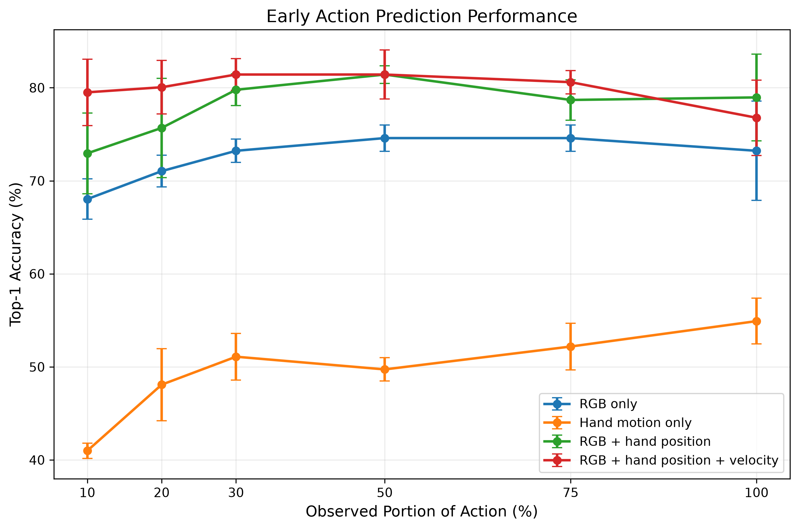
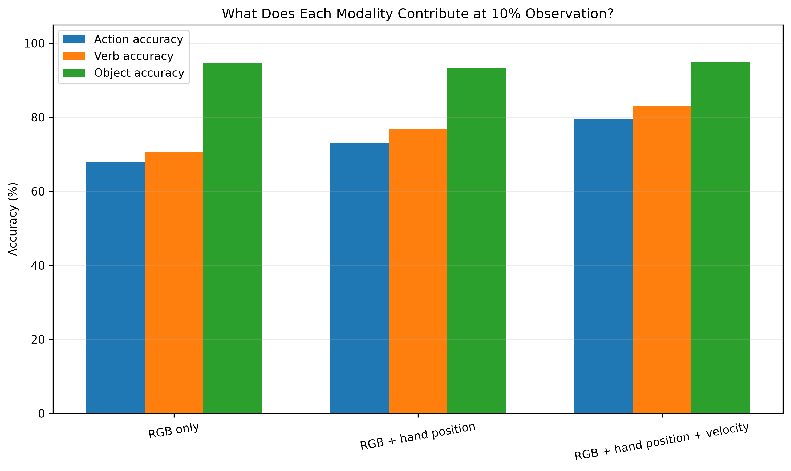
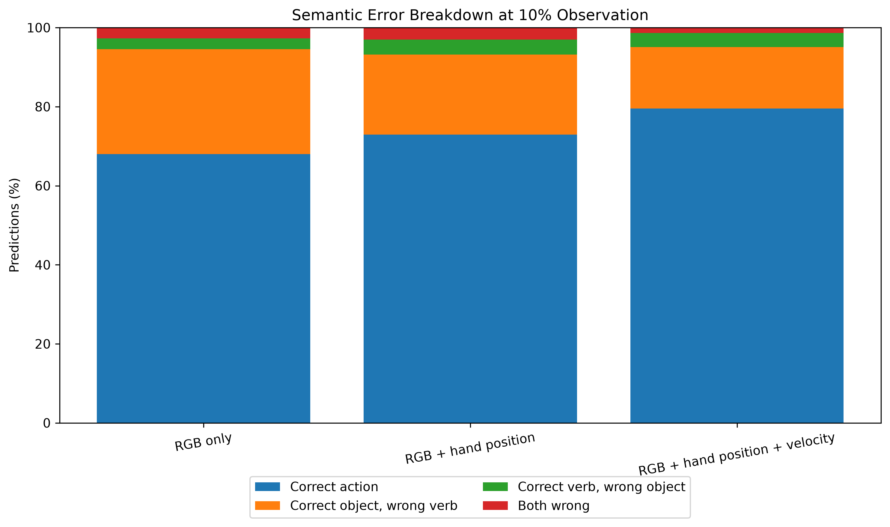

# Early Hand-Object Intent Prediction from Partial 3D Interactions

This project investigates how early a human action can be predicted from partial egocentric hand-object interactions.

The central research question is:

> How early can we infer a user's intended action from visual context and partial 3D hand motion?

Using the H2O dataset, we study action prediction at 10%, 20%, 30%, 50%, 75%, and 100% observation of an interaction. The final system combines RGB appearance with 3D hand pose and temporal hand-motion information using hand-conditioned cross-attention.

---

## Main Result

At only **10% observation**, the full RGB + hand position + velocity model achieves:

- **79.51% Top-1 accuracy**
- compared with **68.03% for RGB-only**
- an improvement of **+11.48 percentage points**

The benefit of explicit hand motion is strongest during the earliest stages of an interaction.



---

## Motivation

Early intent prediction is useful for:

- human-robot interaction
- assistive systems
- anticipatory interfaces
- embodied AI
- collaborative robotics

A visual model can often recognize which object is present very early in an interaction. However, object identity alone does not reveal what the person intends to do with that object.

For example, seeing a milk container may not distinguish between:

- grabbing milk
- placing milk
- opening milk
- closing milk
- pouring milk

This project investigates whether 3D hand configuration and temporal motion can resolve this ambiguity before the action is completed.

---

## Dataset

Experiments use the H2O human-object interaction dataset.

The processed dataset contains synchronized:

- egocentric RGB frames
- depth frames
- 3D hand pose
- action annotations

The action space contains **36 valid verb-object combinations**.

Examples include:

- grab milk
- place cocoa
- open milk
- close chips
- take out cappuccino
- put in espresso
- apply lotion
- pour milk

The official validation split contains **122 action segments**.

---

## Partial Observation Protocol

Each action is evaluated at:

- 10%
- 20%
- 30%
- 50%
- 75%
- 100%

of the observed action sequence.

The number of real temporal samples increases with observation:

| Observation | Real temporal samples |
|---:|---:|
| 10% | 4 |
| 20% | 8 |
| 30% | 12 |
| 50% | 16 |
| 75% | 24 |
| 100% | 32 |

All sequences use a maximum length of 32 with masked padding.

This prevents the model from receiving the same number of temporal observations at every anticipation fraction.

---

## Models

### RGB Only

A frozen ImageNet-pretrained ViT-B/16 extracts RGB features.

The temporal RGB sequence is then processed using a Transformer encoder.

### Hand Motion Only

The hand-only baseline uses:

- wrist-relative 3D hand joint coordinates
- frame-to-frame changes in those coordinates

This model contains no RGB information.

### RGB + Hand Position Cross-Attention

3D hand-position tokens are used as queries over RGB temporal features using cross-attention.

This tests whether hand-conditioned visual fusion improves prediction independently of explicit hand velocity.

### RGB + Hand Position + Velocity Cross-Attention

The final model combines:

- frozen ViT RGB features
- wrist-relative 3D hand position
- temporal hand-motion features
- hand-conditioned cross-attention
- temporal Transformer fusion

The RGB encoder remains frozen while the multimodal fusion layers are trained.

---

## Main Quantitative Results

Results are averaged over **three random seeds: 10, 42, and 100**.

### Top-1 Accuracy

| Observation | Hand Motion Only | RGB Only | RGB + Hand Position | RGB + Hand Position + Velocity |
|---:|---:|---:|---:|---:|
| 10% | 40.98 ± 0.82 | 68.03 ± 2.17 | 72.95 ± 4.34 | **79.51 ± 3.57** |
| 20% | 48.09 ± 3.87 | 71.04 ± 1.71 | 75.68 ± 5.33 | **80.05 ± 2.88** |
| 30% | 51.09 ± 2.50 | 73.22 ± 1.25 | 79.78 ± 1.71 | **81.42 ± 1.71** |
| 50% | 49.73 ± 1.25 | 74.59 ± 1.42 | **81.42 ± 0.95** | **81.42 ± 2.63** |
| 75% | 52.19 ± 2.50 | 74.59 ± 1.42 | 78.69 ± 2.17 | **80.60 ± 1.25** |
| 100% | 54.92 ± 2.46 | 73.22 ± 5.33 | **78.96 ± 4.66** | 76.78 ± 4.04 |

The full model provides its largest gains during the earliest observation windows.

---

## What Does Each Modality Contribute?

At **10% observation**:

| Model | Action Accuracy | Verb Accuracy | Object Accuracy |
|---|---:|---:|---:|
| RGB only | 68.03% | 70.77% | 94.54% |
| RGB + hand position | 72.95% | 76.78% | 93.17% |
| RGB + hand position + velocity | **79.51%** | **83.06%** | **95.08%** |



The full model improves:

- action recognition by **+11.48 pp**
- verb recognition by **+12.30 pp**
- object recognition by only **+0.55 pp**

This indicates that RGB already provides strong object information very early.

The hand stream primarily helps determine **what the user is doing with the object**.

---

## Verb Ambiguity

At 10% observation:

- RGB correct-object / wrong-verb errors: **26.50%**
- Full-model correct-object / wrong-verb errors: **15.57%**

Across all three seeds:

- RGB-only: **97** same-object / wrong-verb errors
- RGB + hand position: **74**
- RGB + hand position + velocity: **57**

This corresponds to roughly a **41% reduction** in same-object / wrong-verb mistakes compared with RGB-only.



This supports the interpretation that motion helps resolve action ambiguity after the object has already been recognized.

---

## Motion-Sensitive Actions

Some of the largest improvements from explicit hand motion occur for actions where direction and interaction dynamics matter.

Examples include:

- close milk
- take out cocoa
- open milk
- open chips
- pour milk
- apply spray
- take out cappuccino

For example:

### Close Milk

Position-only accuracy:

**22.22%**

Position + velocity accuracy:

**88.89%**

The confusion:

```text
close milk -> open milk